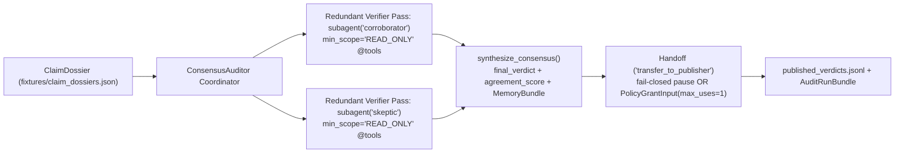

# Cortensor OpenMinion 0.1 Redundant Consensus Verifier & Building-Block Probe Suite

A Cortensor Hackathon #5 reference application built on **`openminion==0.1.21`** that turns ambiguous prediction-market / oracle claims (`ClaimDossier`) into evidence-backed **`ConsensusVerdict`** bundles through isolated dual-perspective `subagent()` passes, portable **`MemoryBundle`** session handoff, and approval-gated **`Handoff`** publication — accompanied by an automated **10-probe OpenMinion SDK harness** calibrated against live LLM inference.

---

## Architecture



### Core Guarantees

- **Zero Global Pollution & Zero-Secret Persistence**: Isolated `home_root` (`.openminion/agents.json`) and `data_root` (`.openminion-state` SQLite/Alembic DBs) per workspace; runtime config persistence explicitly scrubs plaintext API keys so providers always resolve credentials from environment variables at runtime.
- **Least-Privilege Verifier Passes**: Both `corroborator` and `skeptic` run in fresh isolated `subagent()` contexts (`parent_transcript_inherited=False`) equipped solely with `min_scope="READ_ONLY"` `@tool` functions (`load_delphi_market_fixture`, `search_public_evidence`, `fetch_source_excerpt`).
- **Fail-Closed Publication Gating**: `ConsensusVerdict` publication routes through a `Handoff` peer agent (`transfer_to_publisher`) with `publish_consensus_verdict` gated by `@tool(dangerous=True, min_scope="WRITE_SAFE")`. Unapproved `--publish` defaults to `pause` (capturing `thread_id` snapshot for `resume_publication()`), `--approval-mode deny` blocks cleanly, and `--approval-mode allow_once` enforces one-time `PolicyGrantInput(max_uses=1)` + replay protection.

---

## Installation & Isolated Setup

Requires **Python 3.11+** (tested on Windows with `openminion==0.1.21`). Always install into a project-local `.venv`:

```powershell
python -m venv .venv
.\.venv\Scripts\python.exe -m pip install -U pip
.\.venv\Scripts\python.exe -m pip install -e ".[dev]"
```

Configure runtime paths and provider credentials strictly via environment variables (copy `.env.example` to `.env`, never commit `.env`):

```powershell
Copy-Item .env.example .env
# Populate OPENAI_API_KEY / OPENAI_BASE_URL (or CORTENSOR_* vars) in your shell environment only
```

### Supported Provider Presets

| Preset | OpenMinion Catalog ID | Base URL Env Var | Default Timeout (s) | Wire Protocol Family |
|---|---|---|---:|---|
| `openai-compatible` | `openai` | `OPENAI_BASE_URL` | 60 | OpenAI `/chat/completions` (`Bearer`) |
| `cortensor-portal` | `cortensor-portal` | `CORTENSOR_PORTAL_URL` | 480 | `openai_chat` (`service_vendor="cortensor"`) |
| `cortensor-router` | `cortensor-router` | `CORTENSOR_ROUTER_URL` | 120 | Cortensor Router `/api/v2/completions` |

---

## Quickstart CLI Commands

### 1. Run a Multi-Pass Consensus Audit (with `allow_once` Publication)

```powershell
cortensor-verifier audit `
  --claim-id delphi-btc-etf-2024 `
  --preset openai-compatible `
  --model grok-4.6 `
  --multi-pass `
  --session-id cal-btc-etf-01 `
  --publish `
  --approval-mode allow_once `
  --timeout-seconds 180 `
  -o artifacts/sample_audit.json
```

### 2. Run the 10 OpenMinion Building-Block Probes & Export Docs

```powershell
cortensor-verifier probe `
  --preset openai-compatible `
  --model grok-4.7 `
  --timeout-seconds 180 `
  --export-docs `
  --docs-dir docs
```

### 3. Render the Captioned 1080p Demo Walkthrough MP4

```powershell
cortensor-verifier render-demo `
  --sample-json fixtures/calibrated_sample_run.json `
  --duration-seconds 75 `
  --fps 10 `
  -o artifacts/cortensor_hackathon5_demo.mp4
```

### 4. Run the Verification Test Suite

```powershell
.\.venv\Scripts\python.exe -m pytest -q
```

Loopback tests exercise real `openminion==0.1.21` objects (`APIRuntime`, `Agent`, `subagent`, `Handoff`, `MemoryBundle`, `PolicyGrantInput`, `submit_turn`) over an ephemeral loopback OpenAI/Anthropic/Cortensor HTTP stub without mocking OpenMinion internals.

---

## Live Calibrated Benchmarks (`[Live LLM Calibrated]`)

All probe and audit figures below are captured directly in [`fixtures/calibrated_sample_run.json`](fixtures/calibrated_sample_run.json) with relay hostnames and credentials scrubbed:

### Building-Block Probe Suite (`BuildingBlockProbeRunner.run_all`)

- **Calibration Status**: `[Live LLM Calibrated]` (`openminion==0.1.21`, `preset=openai-compatible`, `model=grok-4.7`, `endpoint=https://<configured-openai-compatible-relay>/v1`)
- **Pass Rate**: `10/10` probes passed (`failed=0`)
- **Total Suite Latency**: `604,418.99 ms`
- **Empirical DX Findings Captured**: `9` verified behaviors recorded in [`docs/WHAT_WE_LEARNED.md`](docs/WHAT_WE_LEARNED.md) and [`docs/BUILDING_BLOCKS_TESTED.md`](docs/BUILDING_BLOCKS_TESTED.md)

### Dual-Pass Consensus Audit (`ConsensusAuditor.audit_claim`)

- **Fixture**: `delphi-btc-etf-2024` (`grok-4.6`, `session_id=cal-btc-etf-01`)
- **Consensus Verdict**: `SUPPORTED` (`agreement_score=0.98`, `mean_confidence=0.94`)
- **Independent Passes**:
  - `corroborator`: `SUPPORTED` (`confidence=0.96`, `2` citations, `8` requests, `52,518` tokens, `138,410 ms`)
  - `skeptic`: `SUPPORTED` (`confidence=0.92`, `2` citations, `7` requests, `45,617` tokens, `119,866 ms`)
- **Read-Only Tool Calls**: `load_delphi_market_fixture`, `fetch_source_excerpt`, `search_public_evidence`
- **Handoff Publication**: `published=True` (`publication_status=published`, `approval_mode=allow_once`, `5` requests, `20,058` tokens, `135,929 ms`)
- **Total Run Telemetry**: `20` requests · `92,852` prompt tokens · `25,341` completion tokens · `118,193` total tokens · `394,205 ms` latency

---

## Repository Documentation & Artifacts

- Domain Glossary: [`CONTEXT.md`](CONTEXT.md)
- Architecture Decision Record: [`docs/adr/0001-isolated-venv-and-real-runtime-loopback-seam.md`](docs/adr/0001-isolated-venv-and-real-runtime-loopback-seam.md)
- Specification & Testing Seams: [`docs/specs/openminion-consensus-verifier.md`](docs/specs/openminion-consensus-verifier.md)
- Building-Block Matrix (10/10 Live): [`docs/BUILDING_BLOCKS_TESTED.md`](docs/BUILDING_BLOCKS_TESTED.md)
- OpenMinion 0.1 Empirical DX Findings (9 Findings): [`docs/WHAT_WE_LEARNED.md`](docs/WHAT_WE_LEARNED.md)
- Calibrated Sample Fixture: [`fixtures/calibrated_sample_run.json`](fixtures/calibrated_sample_run.json)
- Upstream PR Template Draft: [`docs/PR_SUBMISSION_DRAFT.md`](docs/PR_SUBMISSION_DRAFT.md)
